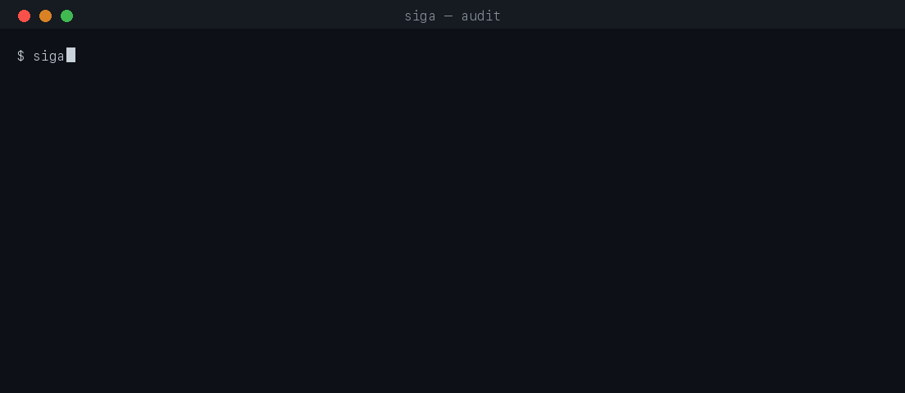

# siga-cli

[](https://github.com/c1-run/siga/actions)
[](https://opensource.org/licenses/MIT)

Open-source core of the **siga** audit engine — Honesty / Reproducibility / Verdict.



*(the gif is generated from live CLI output — `python docs/make_demo.py` rebuilds
it, so it cannot drift from the release it advertises.)*

We audit trading strategies and publish verdicts, not curves. This repo is the free,
MIT-licensed core: the same plumbing we use in production, plus the `siga` CLI.

## Packages

| Package | What it is |
|---|---|
| `siga-audit` | **Backtest audit engine** — OOS verdict, cost sensitivity, small-sample guard |
| `siga-trail` | Append-only JSONL audit trail — verdicts are recorded, not just printed. Zero dependencies |
| `siga-core` | Core types, SQLite state store, and async event bus |
| `siga-common` | Lightweight utilities — logging, time, telemetry, test helpers |
| `siga-book` | Single-frame L2 order book summaries. Zero dependencies |
| `siga-briefing` | The `siga` CLI — portfolio-aware daily briefing |
| `siga-connect` | Data connectors — pull trade history from Binance, Dune, Helius (optional) |

## Install

Requires Python 3.11+.

```bash
git clone https://github.com/c1-run/siga && cd siga
pip install ./siga-common ./siga-core ./siga-book ./siga-trail ./siga-audit ./siga-briefing

# optional: data source connectors (binance, dune, helius)
pip install ./siga-connect
```

For development (editable installs + test tooling):

```bash
pip install -e ./siga-common -e ./siga-core -e ./siga-book -e ./siga-trail -e ./siga-audit -e ./siga-briefing
pip install pytest ruff
```

## Quickstart — audit a backtest

```bash
siga audit siga-audit/examples/trades_sample.csv
```

Real output (the bundled CSV is synthetic — built so the OOS leg fails):

```
siga audit — siga-audit/examples/trades_sample.csv
================================================================
Full sample   n=120   mean=-6.89   (informational only — never the verdict)
IS  (70%)      n=84    mean=+5.04   t=+0.89  p=0.3778
OOS (30%)      n=36    mean=-34.75   t=-3.45  p=0.0015

CHECK 01  OOS verdict ........... t=-3.45, p=0.0015 (significant, gross per ticket)
CHECK 02  Cost sensitivity ...... gross edge -34.75/trade — already negative before any cost
CHECK 03  Small-sample guard .... OOS n=36 >= 30 (ok)

VERDICT: FAIL
  - OOS edge significant and negative (t=-3.45, p=0.0015)

note: verdict is gross of costs — use --cost or --cost-bps for net
```

```bash
siga audit your_trades.csv --cost 10       # the verdict is judged net of this
siga audit your_trades.csv --cost-bps 10   # net of bps-of-notional (needs a notional column)
siga audit your_trades.csv --cluster-days  # one day counts once, not fifty (needs a time column)
siga audit your_trades.csv --json          # machine-readable
siga audit your_trades.csv --trail ~/.siga/audit.jsonl   # verdicts recorded, append-only
```

**Measure the doubt, not just the answer.** `--plant` injects a known edge into one
labeled stratum and reports the smallest edge the log could have proved. It exists
because `no edge found` and `no edge big enough to find here` are different answers:

```bash
# bundled CSV: 1,500 trades over 60 days, two arms, a thin gross edge a 30/trade
# round trip eats
siga audit siga-audit/examples/plant_sample.csv --cost 30 --cluster-days \
      --plant --stratum pullback --deltas 0,10,20,30,40
```

Real output of that command:

```
PLANT — 'pullback': 750 of 1500 trades, net of 30.0000/trade, judged on 18 daily means
 planted delta   judged n       mean        t         p  verdict
        0.0000         18    -8.4558    -0.88    0.3888  INCONCLUSIVE
       10.0000         18    +1.5442    +0.16    0.8736  INCONCLUSIVE
       20.0000         18   +11.5442    +1.21    0.2438  INCONCLUSIVE
       30.0000         18   +21.5442    +2.25    0.0377  PASS
       40.0000         18   +31.5442    +3.30    0.0042  PASS
control: the contrast leaves the whole-log mean where it found it (+13.7573 -> +13.7573) — the plant is only visible inside the stratum
smallest planted edge this log can prove: 30.0000/trade — a FAIL/INCONCLUSIVE here only rules out edges bigger than that
```

The `control` line is the point: the plant lifts the stratum and takes the same
total back out of the rest of the log, so the population mean cannot move. If a
whole-log verdict *does* move, it was not the planted edge that moved it.

The CSV needs one row per trade, chronological, with a P&L column
(`pnl`, `profit`, `return`, … auto-detected, or `--column name`). For
`--cluster-days`, a time column (`ts`, `time`, `exit_ms`, `date`, …); exit time is
preferred over signal time when both exist, because an outcome is only a fact once
it has settled. For `--plant`, a stratum column (`arm`, `label`, `symbol`, …).

### Verdict rules (non-negotiable)

- **Verdict comes from OOS only.** Full-sample numbers are informational.
- **Cost is part of the verdict, not a footnote.** With `--cost` / `--cost-bps`, the
  verdict is judged on the net series; without it, gross. A gross edge that costs
  more than it earns is not an edge, and it does not get a PASS.
- **`--cluster-days` judges the day.** The statistic is read on per-UTC-day means and
  floored at `--min-days` days: 50 trades that all settled on the same afternoon are
  one observation, not fifty.
- **PASS** requires all three: judged OOS n ≥ 30, two-tailed p < 0.05, and a positive
  judged OOS mean.
- **PASS is not a profitability guarantee.** It describes this audit's result for
  this trade log and its stated assumptions; it does not establish future returns.
- **FAIL** requires judged OOS n ≥ 30 and a significantly negative judged edge (p < 0.05).
- **INCONCLUSIVE** covers everything else: OOS n < 30 (we would rather give no answer
  than a fake one), or n ≥ 30 with p ≥ 0.05. No evidence of edge is not evidence of no edge.
- **p-values are exact** (t-distribution via incomplete beta), not normal approximations.
- **A verdict without a plant is uncalibrated.** If the ladder never reaches PASS, the
  honest report is "this log cannot prove an edge that large" — not "there is none".

## Quickstart — pull from a data source

```bash
# Binance (public market data)
siga fetch --from binance --symbol BTCUSDT --output btc_trades.csv

# Binance (your actual trades, requires API key)
siga fetch --from binance --symbol BTCUSDT --api-key $KEY --api-secret $SECRET --output my_trades.csv

# Dune (query results)
siga fetch --from dune --query-id 12345 --api-key $DUNE_KEY --output trades.csv

# Helius (Solana address)
siga fetch --from helius --address $SOL_ADDR --api-key $HELIUS_KEY --output trades.csv

# Audit directly without saving CSV
siga audit --from binance --symbol BTCUSDT --api-key $KEY --api-secret $SECRET
```

## Quickstart — portfolio

```bash
siga portfolio add SOL 10 --cost 142.50
siga portfolio import examples.csv   # or siga-briefing/examples/portfolio.csv
siga portfolio value                 # current value and P&L
siga portfolio brief                 # portfolio-aware daily briefing
```

## Run the tests

```bash
pytest siga-common siga-core siga-book siga-trail siga-audit siga-briefing siga-connect
```

The README's demo gif is a build artifact of the CLI, not a drawing:

```bash
pip install pillow        # dev-only; no siga package depends on it
python docs/make_demo.py  # re-encodes docs/demo.gif from real `siga audit` output
```

## Why "verdict, not curves"

Backtest tools hand you an equity curve and leave the judgment to you. We started
by auditing our own strategies first — four of them died under the audit
(lookahead leaks, cost drag, overfit parameters), one survived. Every check in
this toolchain exists because it killed something we believed in.

Those reviews leaned on private forensics tooling — AST-level leak detection and
multiple-testing penalties. What this repo ships is the out-of-sample / cost /
sample-size part: the checks you can reproduce from a trade log.

Verdicts are **PASS / FAIL / INCONCLUSIVE** — small samples force INCONCLUSIVE.
No third kind of talk.

### siga is a linter, not an engine

Every other tool answers *"how do I backtest?"* — backtrader, vectorbt, freqtrade
and QuantStats give you engines, indicators, charts, and speed. siga answers a
different question: **"is this backtest actually real?"**

That's why it's not a competitor to those projects — it's a complement. Its input
is a plain trade log, so it audits the output of *any* backtester:

```bash
# backtrader / vectorbt / Excel → a CSV → a verdict
siga audit whatever_you_ran.csv
```

The closer analogy is a linter: `pylint` never runs your code, it judges it.
`siga` never runs your strategy, it judges it.

### Why a verdict is the missing piece

Running strategies and judging them are different jobs. Engines are built to run
strategies well — and judgment gets left to you, usually with the equity curve
still glowing on screen. siga does only the second job. The differentiation here
isn't a cleverer statistic (OOS splits and t-tests are textbook). It's a
discipline: **refusing to give a flattering answer**, especially the ones nobody
wants to hear:

- `OOS n < 30` → INCONCLUSIVE. We would rather give no answer than a fake one.
- The verdict comes from out-of-sample data only. Full-sample numbers are noise
  dressed as evidence.
- p-values are exact, not normal approximations — because small samples are
  exactly where the lie usually hides.

### The uncomfortable question: why is any of this open source?

Fair question, and worth answering head-on: a lot of open-source trading tools
are open *because* they have no alpha. When the strategy isn't the product, the
code has to be. We'd rather say it ourselves than let you wonder.

So, plainly:

- **Open: the measurement machinery.** The checks, the verdict rules, the
  discipline. Four of our own strategies died under them. That's not a confession
  — that's the product demo.
- **Closed: whatever survived.** A strategy that passes the audit doesn't get
  published; it gets traded. That asymmetry is deliberate, and it's also your
  product strategy: whatever we eventually charge for will be built on the
  survivors, so the audit itself has no incentive to flatter anyone. A PASS is
  not proof of profitability or a promise about future performance.

One piece of advice, because it will save you the most money:

**Don't build the giant repo first.** The most expensive mistake in this field
isn't a losing strategy — it's six months of infra (executors, dashboards, risk
engines) built around a strategy that was never real. Audit the trade log first:
one CSV, one command, one hour. A FAIL verdict is the cheapest possible outcome —
you just skipped the infra. That's the highest-ROI hour in quantitative trading.

**Measure before you build.**

## License

MIT — see [LICENSE](LICENSE).
